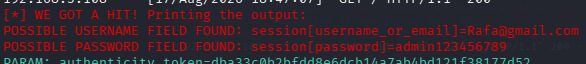
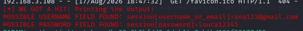

# Simulacao de Engenharia Social e Phishing em Ambiente de Testes

Laboratorio pratico de seguranca ofensiva simulando ataque de credential harvesting com Social-Engineer Toolkit (SEToolkit) no Kali Linux para conscientizacao e auditoria defensiva.

> **AVISO LEGAL E ETICA PROFISSIONAL:**  
> Este projeto foi executado estritamente em ambiente controlado e isolado de laboratorio para fins educacionais de conscientizacao em seguranca da informacao. O uso nao autorizado dessas tecnicas contra pessoas, redes ou sistemas de terceiros e ilegal. O objetivo deste documento e demonstrar como o vetor de ataque opera para embasar estrategias eficientes de defesa e prevencao.

## Visao geral

A engenharia social continua sendo um dos principais vetores de invasao e comprometimento de credenciais em organizacoes no mundo todo. Este laboratorio documenta o fluxo mecânico de clonagem de interface e captura de dados de autenticacao atraves da ferramenta SEToolkit, evidenciando como links enganosos podem ludibriar usuarios desatentos e expondo a necessidade imperativa de mecanismos de autenticacao multifator (MFA).

## Ferramentas e Ambiente de Laboratorio

| Componente | Especificacao |
|---|---|
| Sistema Operacional | Kali Linux |
| Framework de Ataque | Social-Engineer Toolkit (SEToolkit) |
| Vetor de Simulacao | Web Site Attack Vectors |
| Metodo de Captura | Credential Harvester Attack Method (Site Cloner) |
| Alvo da Simulacao | Pagina de autenticacao de rede social em ambiente isolado |

## Execucao da Simulacao

O fluxo operacional do laboratorio segue os seguintes passos:

1. **Elevacao de privilegios:**
```bash
sudo su
```

2. **Inicializacao do framework SEToolkit:**
```bash
setoolkit
```

3. **Navegacao e selecao de modulos:**
- Menu 1: `Social-Engineering Attacks`
- Menu 2: `Website Attack Vectors`
- Menu 3: `Credential Harvester Attack Method`
- Menu 4: `Site Cloner`

4. **Definicao de parametros de rede e clone:**
- Configuracao do endereco IP local do Kali para escuta (Harvester listener).
- Insercao da URL alvo para clonagem da pagina de login.

## Evidencias e Resultados da Simulacao

Apos a submissao dos dados de acesso na interface clonada pelo cliente de teste, o listener do SEToolkit intercepta as variaveis de requisicao POST em texto claro no terminal do atacante:

### 1. Captura inicial do formulario e parametros de envio
Intercepcao da conexao e captura do pacote contendo os parametros de autenticacao:


### 2. Extracao das credenciais capturadas
Exibicao direta das variaveis de usuario e senha coletadas pelo processo harvester:


## Medidas de Defesa e Mitigacao

Para neutralizar de forma eficaz os riscos associados a este vetor de ataque, recomendam-se as seguintes praticas defensivas:

1. **Autenticacao Multifator Obrigatoria (MFA):** Adocao de chaves fisicas de seguranca (FIDO2/WebAuthn) ou autenticadores temporizados baseados em app (TOTP), que tornam a posse exclusiva da senha insuficiente para acesso a conta.
2. **Inspecao de URL e Certificados Digitais:** Treinamento continuo de colaboradores para verificacao do nome de dominio exato e validade de certificados SSL/TLS antes da insercao de dados sensiveis.
3. **Filtros Antiphishing e DNS Seguro:** Utilizacao de gateways de seguranca de e-mail e provedores de DNS com listas dinamicas de bloqueio de dominios recem-registrados ou suspeitos.
4. **Gerenciadores de Senha com Preenchimento Automatico Fiel:** Os gerenciadores de senha vinculam a credencial ao dominio oficial e recusam o autopreenchimento caso o dominio seja diferente, mitigando falhas humanas.
